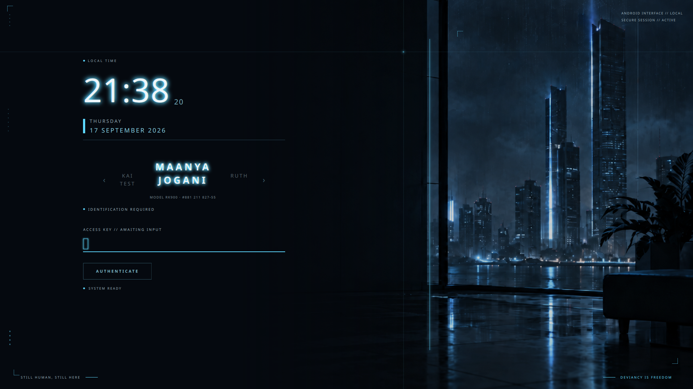
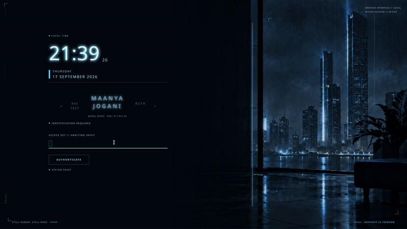
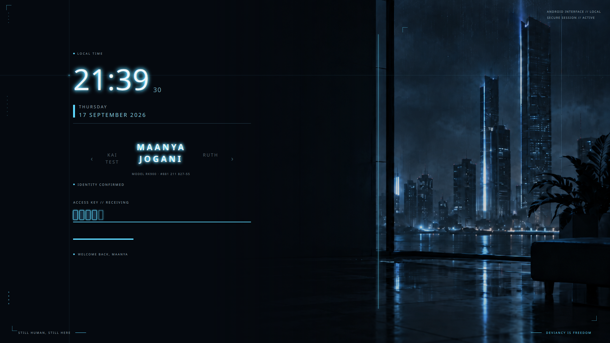
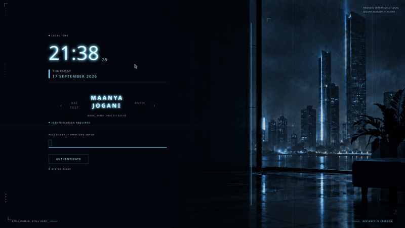
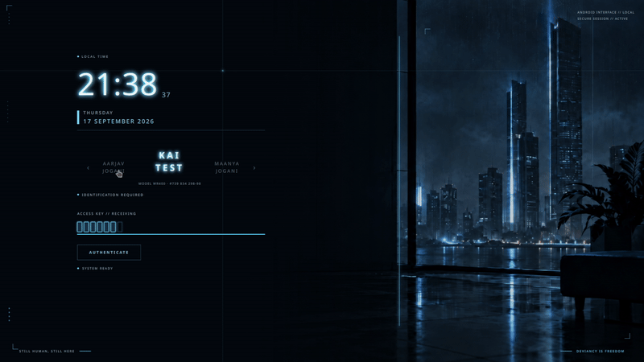

# Deviancy

A cinematic cyberpunk SDDM login theme with a matching Plasma 6 splash screen.

Deviancy is an original SDDM login theme inspired by the quiet, eerie interface
aesthetic of android identity verification — restrained, mechanical, and alive
in its details. It is not affiliated with, derived from, or redistributing any
game assets. All artwork is original.

## Features

- Glowing clock, roaming scanlines, and a cinematic cityscape background
- Multi-user carousel and custom password cells
- Animated authentication feedback connected to SDDM
- Matching Plasma splash with a restoration checklist and WELCOME HOME greeting

## Preview



### See it in motion



[Watch the authentication video](Previews/clips/5-successful-auth.mp4)

<details>
<summary><strong>See more screenshots and videos</strong> — click to expand the gallery</summary>

### Screenshots

| Idle | Typing |
|:---:|:---:|
|  |  |

| Authentication success | Authentication failure |
|:---:|:---:|
|  |  |

### More animations

| State | Animated preview | Video |
|:---|:---:|:---:|
| Idle (scanlines roaming) |  | [MP4](Previews/clips/1-idle.mp4) |
| Typing (password cells) |  | [MP4](Previews/clips/2-typing.mp4) |
| Access denied |  | [MP4](Previews/clips/3-access-denied.mp4) |
| Switching profiles |  | [MP4](Previews/clips/4-switching-profiles.mp4) |

These previews show the SDDM greeter. The matching splash continues the visual
theme after login.

</details>

## Requirements

| Component | Requirements |
| --- | --- |
| SDDM greeter | Qt 6 capable SDDM; QtQuick, QtQuick.Controls, Qt5Compat.GraphicalEffects; physical keyboard |
| Plasma splash | Plasma 6; ksplashqml; QtQuick and Qt5Compat.GraphicalEffects |

The two themes install separately. Plasma is optional for the greeter.
See the guides for compatibility notes and package requirements.

## Get started

```bash
git clone https://github.com/MaanyaJogani/deviancy.git
cd deviancy
```

Choose the component you want to install:

- [SDDM greeter guide](docs/sddm.md) — installation, activation, previewing,
  authentication behavior, and troubleshooting
- [Plasma splash guide](docs/splash.md) — installation, activation, previewing,
  and session-stage behavior
- [Customization guide](docs/customization.md) — backgrounds, colors, text,
  and source layout

## License and author

CC-BY-SA 4.0 — see [LICENSE](LICENSE).
Background artwork © Maanya Jogani, CC-BY-SA 4.0.

Created by Maanya Jogani.
